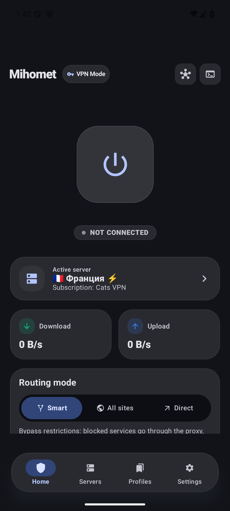
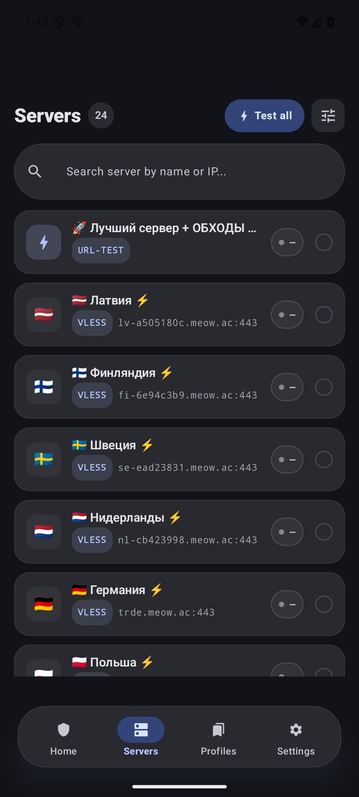
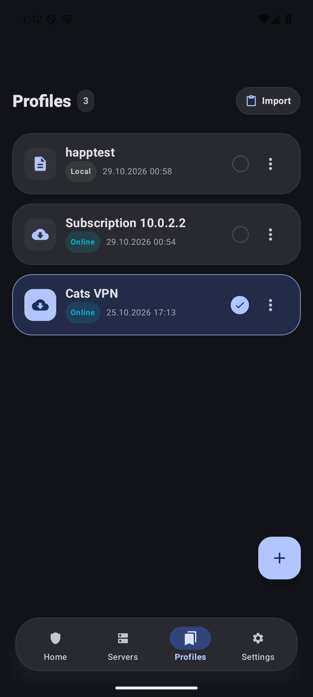
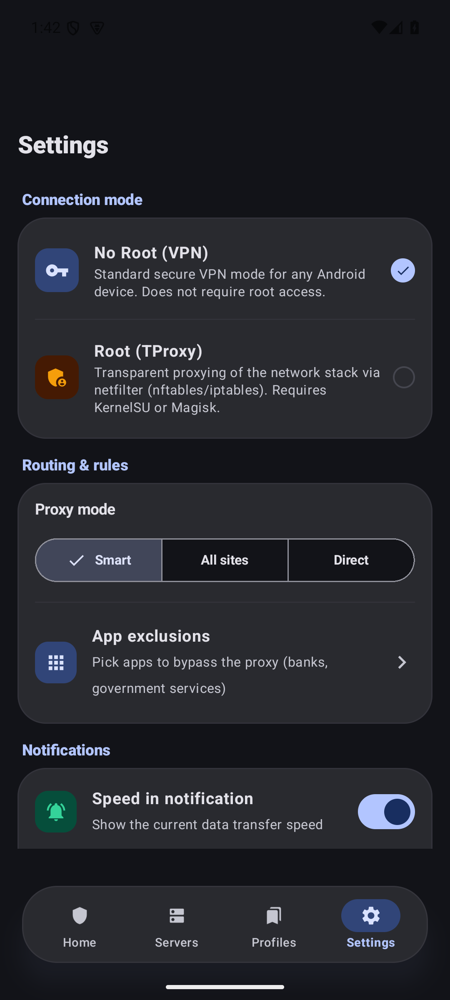

# Mihomet

[](https://github.com/mihomet/mihomet/actions/workflows/ci.yml)
[](LICENSE)
[](https://developer.android.com/about/versions/oreo)
[](https://kotlinlang.org)

**EN.** Mihomet is a modern, fast Android client for the [Mihomo](https://github.com/MetaCubeX/mihomo) core (`Clash.Meta` v1.19+) with a **Material 3 Expressive** interface. It supports both non-root VPN mode (`VpnService` + TUN/gVisor) and root transparent proxying (iptables/nftables), universal subscription conversion (Base64, Clash YAML, sing-box JSON, Xray JSON, share-link URIs incl. VLESS/Reality, VMess, SS/SS2022, Trojan, Hysteria 1/2, TUIC, Snell, WireGuard), per-app proxy, live traffic charts, a true AMOLED theme, and RU/EN localization. Grab a prebuilt APK from [Releases](../../releases) or build it yourself below.

**RU.** Русская версия этого README: [README.ru.md](README.ru.md).

---

## ⚡ Key features

- **Two operating modes:**
  - **Non-Root (VPN):** the standard Android `VpnService` with a TUN/gVisor stack (no root required).
  - **Root (TProxy):** transparent proxying via `iptables` / `nftables` with minimal battery overhead.
- **Material 3 Expressive interface:**
  - Tactile floating navigation and interactive control widgets.
  - A true deep **AMOLED theme** (pure OLED `#000000` with neutral graphite containers and no color tint).
  - Smooth cinematic screen transitions (Shared-Axis motion).
  - Live traffic chart and real-time speed monitoring.
  - Localization: Russian and English.
- **Modern protocol support:**
  - VLESS (Reality, Vision, post-quantum encryption fields), VMess, Shadowsocks (incl. SS2022), Trojan, Hysteria 2, Hysteria (v1), TUIC v5, WireGuard, AnyTLS, ShadowTLS, HTTP/SOCKS5.
- **Universal subscriptions:**
  - Automatic conversion of every popular format: Base64 URI lists, Clash YAML, sing-box JSON, Xray JSON, share links (`vless://`, `vmess://`, `trojan://`, `ss://`, `hysteria2://`, `tuic://`, `snell://`, `wg://`, `ssh://`), incl. SIP003 plugins (simple-obfs, v2ray-plugin).
  - Per-subscription custom headers (e.g. a panel access token) — encrypted at rest together with the URL.
  - Global identity settings: custom `User-Agent`, `x-hwid` on/off + override, per-profile overrides with the precedence *profile > global > default*.
  - Content-aware UA fallback: the UA chain keeps walking while a response has no proxy-groups and prefers the first grouped one — hostile panels work without panel-side changes.
  - Node latency testing (HTTP, TCP, honest ICMP via the system `ping`) even when the core is stopped.
  - Free-form MTU (1280–65535) and TUN stack selection (gVisor / system / mixed).
  - Built-in AUTO auto-balancer: a `url-test` group is synthesized when the panel provides no balancing group, with a configurable node-exclusion pool.
  - In-app language selection independent of the system (Android 13+).
- **Big-client reliability:**
  - Core watchdog: a crashed mihomo restarts automatically with backoff (VPN and root daemon).
  - Background subscription auto-refresh by `profile-update-interval` (WorkManager).
  - Always-on VPN: system service restarts and `onRevoke` are handled correctly.
- **One-tap import and ecosystem compatibility:**
  - Deep links: `happ://add/…`, `happ://routing/…`, `happ://crypt…` (AES-128-GCM), `incy://add|import|crypt…`, `clash://install-config`, `clashmeta://`, `flclash://`, `v2rayng://install-sub`, `sing-box://import-remote`, plus "Share → Mihomet" from the browser.
  - Honest `User-Agent: Mihomet/…` + `x-hwid` device-binding header on subscription fetches; `profile-title`, `New-Url`/`Fallback-Url` (auto-migration) and `Subscription-Userinfo` are parsed.
  - Subscription formats: Base64 URI lists, Clash YAML, sing-box JSON, Xray JSON, vless/vmess/trojan/ss/hysteria(2)/tuic/ssh/snell/wg links.
- **Per-App Proxy (split tunneling):**
  - Pick the apps to route through or around the proxy (whitelist and blacklist).
- **Security by default:**
  - The core REST API listens on `127.0.0.1` only, with a random secret generated on first launch; the probe core gets a fresh random secret and port per run.
  - LAN access disabled; subscription URLs and headers are encrypted (AndroidKeyStore).
  - External-link imports require explicit confirmation; panel hints (auto-select profile, per-app routing, mode switch) apply only after user consent.
  - The core binary is a patched build from [mihomet/core](https://github.com/mihomet/core), verified by sha256 — and runtime core updates additionally by a signed manifest (rollback on any failure).
  - In-app self-update with a fail-closed verifier: semver, version-info.json binding, versionCode monotonicity and signing-certificate equality before anything is installed.

---

## 📸 Screenshots

| Dashboard | Nodes | Profiles | Settings |
|---|---|---|---|
|  |  |  |  |

---

## 📱 System requirements

| | |
|---|---|
| **Minimum OS** | Android 8.0 Oreo (API 26) |
| **Target OS** | Android 16 (compileSdk 37, targetSdk 36) |
| **Architectures** | `arm64-v8a`, `armeabi-v7a`, `x86_64` |

---

## ⬇️ Download

Grab a prebuilt APK from the [Releases](../../releases) page or build it yourself (below). Releases contain per-ABI APKs — most devices need `arm64-v8a`.

> ⚠️ The app is not published on Google Play due to the store's proxy-app policy — use the Releases APKs.

---

## 🛠 Building

### Requirements
- JDK 21
- Android SDK (platform 37)

### Mihomo core

Core binaries are **not stored in git** — they are a patched mihomo build (non-root TUN, idea by Tropa) published at [mihomet/core](https://github.com/mihomet/core) releases. The `downloadMihomoCore` task downloads the pinned release and verifies it by sha256+size (`gradle/mihomo-core.properties`) on the first build. The `.mihomo-core-cache/` directory makes subsequent builds offline-friendly.

### Commands

```bash
# Kotlin compile check
./gradlew compileDebugKotlin

# Unit test suite
./gradlew testDebugUnitTest

# Debug APK
./gradlew assembleDebug
# → app/build/outputs/apk/debug/app-<abi>-debug.apk

# Release APK (without env vars — unsigned)
./gradlew assembleRelease
# → app/build/outputs/apk/release/app-<abi>-release-unsigned.apk

# Install on a connected device via ADB
adb install -r app/build/outputs/apk/debug/app-arm64-v8a-debug.apk
```

Release signing is provided via the `KEYSTORE_FILE`, `KEYSTORE_PASSWORD`, `KEY_ALIAS`, `KEY_PASSWORD` environment variables (repo secrets in CI). Without them the release build is left unsigned.

---

## 🏗 Architecture & stack

- **Language:** Kotlin 2.1 (Coroutines, Flow, Serialization)
- **UI:** Jetpack Compose (BOM 2026.06), Material 3 Expressive
- **DI:** Koin 4.1
- **Storage:** Room 2.8 (profiles and sessions; URLs/headers encrypted), DataStore Preferences (settings)
- **Network client:** Ktor 3 (subscription downloads, traffic WebSocket, core REST API)
- **Core:** `libmihomo.so` — a patched build from [mihomet/core](https://github.com/mihomet/core), downloaded at build time (see above)
- **Quality:** 560+ unit tests, 14 instrumented tests in a CI emulator matrix (API 29/35), Android Lint + detekt, JaCoCo coverage report
- **Agent/contributor documentation:** [AGENTS.md](AGENTS.md)

---

## 🛡 Trust & threat model (read before installing)

- The project's code is **entirely AI-generated** (ZCode/GLM, Antigravity/Gemini) under the direction of a single maintainer who did not write it by hand and **does not vouch for its security**.
- **No independent audit with a named auditor exists.** The internal security review of 2026-10-31 (24 findings, all closed) is a self-report, not an external audit.
- The project is days old: 2 stars, 0 forks, 0 external contributors. Do not treat it like a mature client.
- **Do not use it on your primary phone** for banking or work data. Use a separate profile/device, a throwaway subscription, and avoid the root mode.
- Verify APKs: the per-release SHA-256 table and the certificate fingerprint `b85405a2fae2ef6df0ce370f8a89d6d68e1216380f919def5b32e060ae3110f4`.
- An `x-hwid` device header (a stable device identifier) is sent by default — if you distrust your panel, disable it in Settings → Subscriptions.

## ⚖️ License

Distributed under [GPL-3.0](LICENSE) because it bundles the mihomo core binary (GPL-3.0). The corresponding source of the bundled core (patch + build scripts): <https://github.com/mihomet/core>; upstream: <https://github.com/MetaCubeX/mihomo>.
