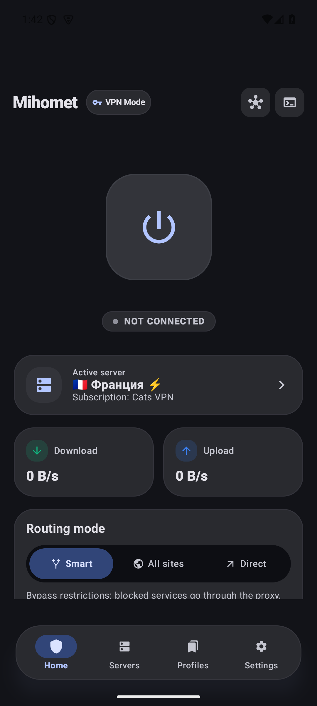
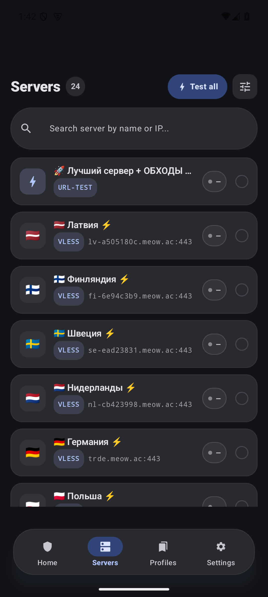
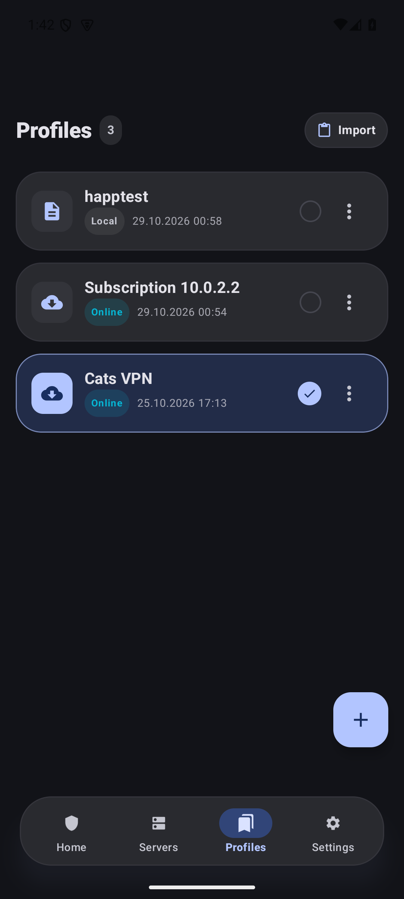
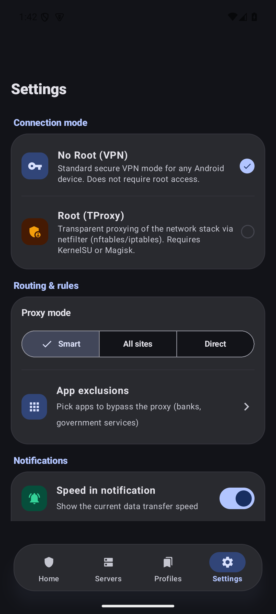

# Mihomet

[](https://github.com/mihomet/mihomet/actions/workflows/ci.yml)
[](LICENSE)
[](https://developer.android.com/about/versions/oreo)
[](https://kotlinlang.org)

**EN.** Mihomet is a modern, fast Android client for the [Mihomo](https://github.com/MetaCubeX/mihomo) core (`Clash.Meta` v1.19+) with a **Material 3 Expressive** interface. It supports both non-root VPN mode (`VpnService` + TUN/gVisor) and root transparent proxying (iptables/nftables), universal subscription conversion (Base64, Clash YAML, sing-box JSON, share-link URIs incl. VLESS/Reality, VMess, SS, Trojan, Hysteria 1/2, TUIC), per-app proxy, live traffic charts, a true AMOLED theme, and RU/EN localization. Grab a prebuilt APK from [Releases](../../releases) or build it yourself below.

---

Современный и быстрый Android-клиент для ядра **Mihomo** (`Clash.Meta` v1.19+) с дизайном **Material 3 Expressive**.

---

## ⚡ Ключевые возможности

- **Два режима работы:**
  - **Non-Root (VPN):** стандартный Android `VpnService` со стеком TUN/gVisor (не требует root-прав).
  - **Root (TProxy):** прозрачное проксирование трафика через `iptables` / `nftables` с минимальной нагрузкой на батарею.
- **Интерфейс Material 3 Expressive:**
  - Тактильная плавающая навигация и интерактивные виджеты управления.
  - Настоящая глубокая **AMOLED-тема** (чистый OLED `#000000` и нейтральные графитовые контейнеры без лишних цветовых примесей).
  - Плавные кинематические переходы между экранами (Shared-Axis motion).
  - График трафика и мониторинг скорости в реальном времени.
  - Локализация: русский и английский.
- **Поддержка современных протоколов:**
  - VLESS (Reality, Vision), VMess, Shadowsocks (включая 2022), Trojan, Hysteria 2, Hysteria (v1), TUIC.
- **Универсальные подписки:**
  - Автоматическая конвертация форматов (Base64, Sing-box JSON, Clash YAML, ссылки `vless://`/`tuic://`/`hysteria://` и др.).
  - Поддержка пользовательских заголовков при загрузке (`x-hwid` для Remnawave, кастомный `User-Agent` и формат JSON / `Ключ: Значение`).
  - Тестирование задержки узлов (HTTP, TCP, ICMP) даже при выключенном ядре.
- **Надёжность как у больших клиентов:**
  - Watchdog ядра: крэш mihomo — авторестарт с backoff (VPN и root-демон), без ручного тыка.
  - Автообновление подписок в фоне по `profile-update-interval` (WorkManager, минимум раз в 6 ч).
  - Always-on VPN: системный рестарт сервиса и `onRevoke` обрабатываются корректно.
- **Однотапный импорт и совместимость с экосистемой:**
  - Deep-links: `happ://add/…`, `happ://routing/…`, `incy://add|import/…`, `clash://install-config`, `clashmeta://`, `flclash://`, `v2rayng://install-sub`, `sing-box://import-remote` и «Поделиться → Mihomet» из браузера.
  - Честный `User-Agent: Mihomet/…` + заголовок `x-hwid` (device-binding) при загрузке подписок; разбор `profile-title`, `New-Url`/`Fallback-Url` (авто-переезд), `Subscription-Userinfo`.
  - Форматы подписок: Base64 URI-списки, Clash YAML, sing-box JSON, Xray JSON, ссылки vless/vmess/trojan/ss/hysteria(2)/tuic/ssh/snell/wg.
- **Раздельное туннелирование (Per-App Proxy):**
  - Выбор приложений для обхода или направления в прокси (белый и чёрный списки).
- **Безопасность по умолчанию:**
  - REST API ядра слушает только `127.0.0.1` со случайным секретом, генерируемым при первом запуске.
  - Доступ к LAN отключён; бинарник ядра скачивается только с официальных релизов Mihomo и проверяется по sha256.

---

## 📸 Скриншоты

| Дашборд | Узлы | Подписки | Настройки |
|---|---|---|---|
|  |  |  |  |


---

## 📱 Системные требования

| Параметр | Значение |
|---|---|
| **Минимальная версия ОС** | Android 8.0 Oreo (API 26) |
| **Целевая версия ОС** | Android 15 / 16 (API 35+) |
| **Поддерживаемые архитектуры** | `arm64-v8a`, `armeabi-v7a`, `x86_64` |

---

## ⬇️ Загрузка

Скачайте готовый APK со страницы [Releases](../../releases) или соберите сами (см. ниже).

> ⚠️ Приложение не публикуется в Google Play из-за политики магазина в отношении прокси-приложений — используйте APK из Releases.

---

## 🛠 Сборка проекта

### Требования
- JDK 21
- Android SDK (API 35, Build-Tools 35.0.0)

### Ядро Mihomo

Бинарники ядра **не хранятся в git** — задача `downloadMihomoCore` скачивает релиз v1.19.33 с официального репозитория [MetaCubeX/mihomo](https://github.com/MetaCubeX/mihomo/releases) и проверяет его по sha256 (`gradle/mihomo-core.properties`) при первой сборке. Каталог `.mihomo-core-cache/` позволяет собираться офлайн после первой загрузки.

### Основные команды

```bash
# Проверка компиляции Kotlin
./gradlew compileDebugKotlin

# Запуск набора unit-тестов
./gradlew testDebugUnitTest

# Сборка Debug APK
./gradlew assembleDebug
# Результат: app/build/outputs/apk/debug/app-debug.apk

# Сборка Release APK (без переменных окружения — unsigned)
./gradlew assembleRelease
# Результат: app/build/outputs/apk/release/app-release-unsigned.apk

# Установка на подключенное устройство через ADB
adb install -r app/build/outputs/apk/debug/app-debug.apk
```

Release-подпись задаётся переменными окружения `KEYSTORE_FILE`, `KEYSTORE_PASSWORD`, `KEY_ALIAS`, `KEY_PASSWORD` (в CI — секретами репозитория).

---

## 🏗 Архитектура и стек

- **Язык:** Kotlin 2.1 (Coroutines, Flow, Serialization)
- **UI:** Jetpack Compose (BOM 2024.12.01), Material 3 Expressive
- **DI:** Koin 3.5.6
- **Хранение данных:** Room (профили и сессии), DataStore Preferences (настройки)
- **Сетевой клиент:** Ktor 2.3.12 (загрузка подписок, WebSocket трафика, REST API ядра)
- **Ядро:** `libmihomo.so` — скачивается при сборке (см. выше)
- **Документация для агентов и контрибьюторов:** [AGENTS.md](AGENTS.md)

---

## ⚖️ Лицензия

Проект распространяется под лицензией [GPL-3.0](LICENSE), поскольку включает бинарник ядра [mihomo](https://github.com/MetaCubeX/mihomo) (GPL-3.0). Соответствующие исходники ядра: <https://github.com/MetaCubeX/mihomo>.
