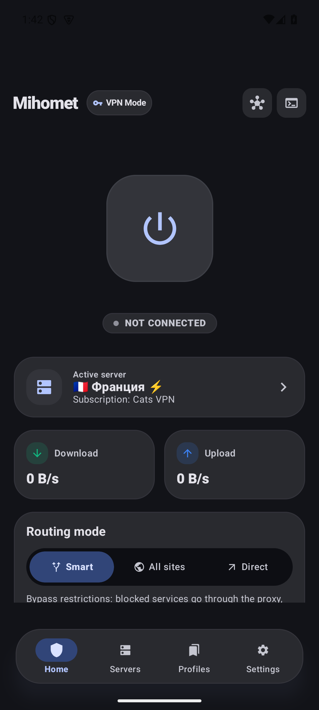
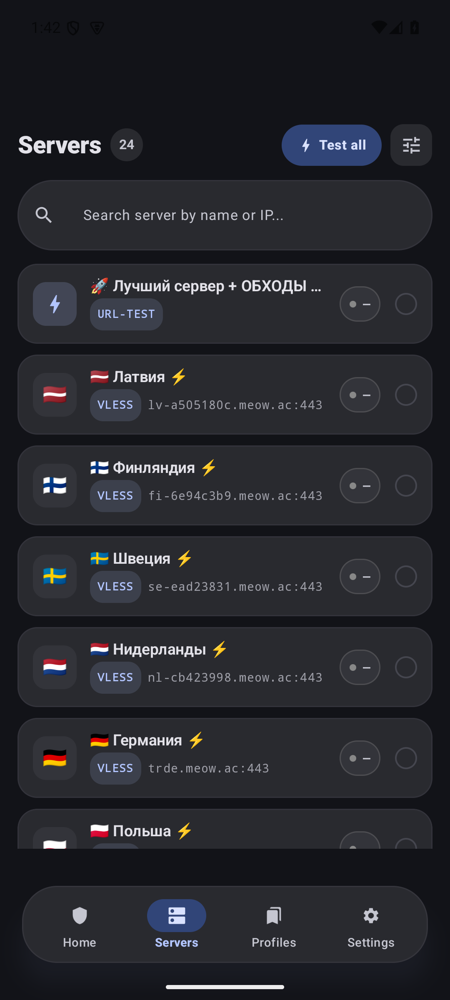
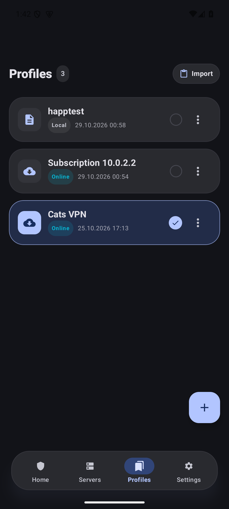
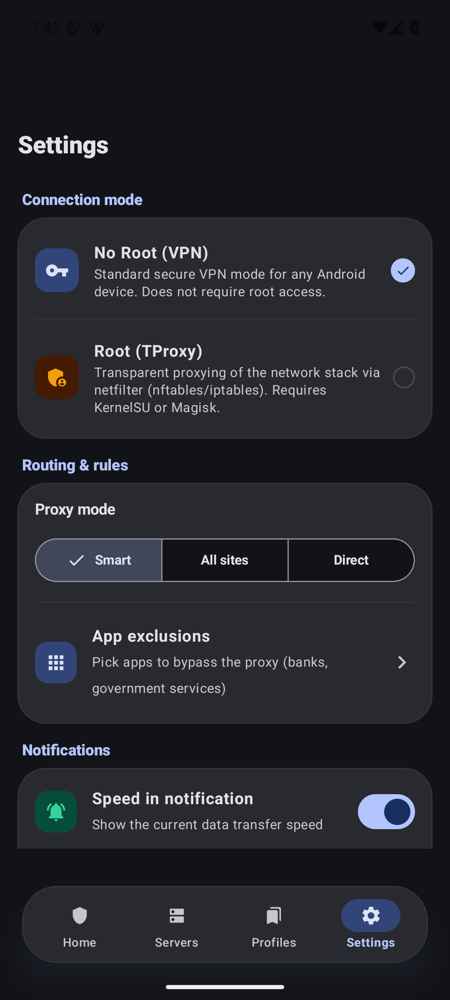

# Mihomet (RU)

[](https://github.com/mihomet/mihomet/actions/workflows/ci.yml)
[](LICENSE)

Русская версия README. Английская (основная): [README.md](README.md).

---

## ⚡ Ключевые возможности

- **Два режима работы:**
  - **Non-Root (VPN):** стандартный Android `VpnService` со стеком TUN/gVisor (не требует root-прав).
  - **Root (TProxy):** прозрачное проксирование трафика через `iptables` / `nftables` с минимальной нагрузкой на батарею.
- **Интерфейс Material 3 Expressive:**
  - Тактильная плавающая навигация и интерактивные виджеты управления.
  - Настоящая глубокая **AMOLED-тема** (чистый OLED `#000000` и нейтральные графитовые контейнеры без лишних цветовых примесей).
  - Плавные кинематические переходы между экранами (Shared-Axis motion).
  - График трафика и мониторинг скорости в реальном времени.
  - Локализация: русский и английский.
- **Поддержка современных протоколов:**
  - VLESS (Reality, Vision), VMess, Shadowsocks (включая 2022), Trojan, Hysteria 2, Hysteria (v1), TUIC.
- **Универсальные подписки:**
  - Автоматическая конвертация форматов (Base64, Sing-box JSON, Clash YAML, ссылки `vless://`/`tuic://`/`hysteria://` и др.).
  - Поддержка пользовательских заголовков при загрузке (`x-hwid` для Remnawave, кастомный `User-Agent` и формат JSON / `Ключ: Значение`).
  - Свои заголовки у каждой подписки (например, токен доступа панели) — шифруются вместе с URL.
  - Глобальные настройки идентификации: свой `User-Agent`, вкл/выкл `x-hwid` и своё значение hwid.
  - Тестирование задержки узлов (HTTP, TCP, честный ICMP через системный `ping`) даже при выключенном ядре.
  - Свободная настройка MTU (1280–65535) и выбор TUN-стека (gVisor / system / mixed).
  - Выбор языка приложения независимо от системы (Android 13+).
- **Надёжность как у больших клиентов:**
  - Watchdog ядра: крэш mihomo — авторестарт с backoff (VPN и root-демон), без ручного тыка.
  - Автообновление подписок в фоне по `profile-update-interval` (WorkManager, минимум раз в 6 ч).
  - Always-on VPN: системный рестарт сервиса и `onRevoke` обрабатываются корректно.
- **Однотапный импорт и совместимость с экосистемой:**
  - Deep-links: `happ://add/…`, `happ://routing/…`, `incy://add|import/…`, `clash://install-config`, `clashmeta://`, `flclash://`, `v2rayng://install-sub`, `sing-box://import-remote` и «Поделиться → Mihomet» из браузера.
  - Честный `User-Agent: Mihomet/…` + заголовок `x-hwid` (device-binding) при загрузке подписок; разбор `profile-title`, `New-Url`/`Fallback-Url` (авто-переезд), `Subscription-Userinfo`.
  - Форматы подписок: Base64 URI-списки, Clash YAML, sing-box JSON, Xray JSON, ссылки vless/vmess/trojan/ss/hysteria(2)/tuic/ssh/snell/wg.
- **Раздельное туннелирование (Per-App Proxy):**
  - Выбор приложений для обхода или направления в прокси (белый и чёрный списки).
- **Безопасность по умолчанию:**
  - REST API ядра слушает только `127.0.0.1` со случайным секретом, генерируемым при первом запуске; probe-ядро получает новый случайный секрет и порт на каждый запуск.
  - Доступ к LAN отключён; ключи подписок и заголовков шифруются (AndroidKeyStore).
  - Импорт по внешним ссылкам — только после подтверждения; подсказки панели (автовыбор профиля, per-app, смена режима) применяются лишь с явного согласия.
  - Бинарник ядра — пропатченная сборка из [mihomet/core](https://github.com/mihomet/core), проверяется по sha256, а рантайм-обновления ядра — ещё и по подписанному манифесту (откат при любой ошибке).

---

## 📸 Скриншоты

| Дашборд | Узлы | Подписки | Настройки |
|---|---|---|---|
|  |  |  |  |


---

## 📱 Системные требования

| Параметр | Значение |
|---|---|
| **Минимальная версия ОС** | Android 8.0 Oreo (API 26) |
| **Целевая версия ОС** | Android 16 (compileSdk 37, targetSdk 36) |
| **Поддерживаемые архитектуры** | `arm64-v8a`, `armeabi-v7a`, `x86_64` |

---

## ⬇️ Загрузка

Скачайте готовый APK со страницы [Releases](../../releases) или соберите сами (см. ниже). Releases содержат APK под каждую архитектуру — для большинства устройств нужен `arm64-v8a`.

> ⚠️ Приложение не публикуется в Google Play из-за политики магазина в отношении прокси-приложений — используйте APK из Releases.

---

## 🛠 Сборка проекта

### Требования
- JDK 21
- Android SDK (platform 37)

### Ядро Mihomo

Бинарники ядра **не хранятся в git** — это пропатченная сборка mihomo (non-root TUN, идея Tropa), публикуемая в релизах [mihomet/core](https://github.com/mihomet/core). Задача `downloadMihomoCore` скачивает запиненный релиз и проверяет его по sha256+размеру (`gradle/mihomo-core.properties`) при первой сборке. Каталог `.mihomo-core-cache/` позволяет собираться офлайн после первой загрузки.

### Основные команды

```bash
# Проверка компиляции Kotlin
./gradlew compileDebugKotlin

# Запуск набора unit-тестов
./gradlew testDebugUnitTest

# Сборка Debug APK
./gradlew assembleDebug
# Результат: app/build/outputs/apk/debug/app-debug.apk

# Сборка Release APK (без переменных окружения — unsigned)
./gradlew assembleRelease
# Результат: app/build/outputs/apk/release/app-release-unsigned.apk

# Установка на подключенное устройство через ADB
adb install -r app/build/outputs/apk/debug/app-debug.apk
```

Release-подпись задаётся переменными окружения `KEYSTORE_FILE`, `KEYSTORE_PASSWORD`, `KEY_ALIAS`, `KEY_PASSWORD` (в CI — секретами репозитория).

---

## 🏗 Архитектура и стек

- **Язык:** Kotlin 2.1 (Coroutines, Flow, Serialization)
- **UI:** Jetpack Compose (BOM 2026.06), Material 3 Expressive
- **DI:** Koin 4.1
- **Хранение данных:** Room 2.8 (профили и сессии; URL/заголовки шифруются), DataStore Preferences (настройки)
- **Сетевой клиент:** Ktor (загрузка подписок, WebSocket трафика, REST API ядра)
- **Ядро:** `libmihomo.so` — пропатченная сборка [mihomet/core](https://github.com/mihomet/core), скачивается при сборке (см. выше)
- **Качество:** 450+ unit-тестов, 14 instrumented-тестов в CI-эмуляторе (API 29/35), Android Lint + detekt
- **Документация для агентов и контрибьюторов:** [AGENTS.md](AGENTS.md)

---

## 🛡 Trust & threat model (прочти перед установкой)

- Код проекта **полностью сгенерирован ИИ-инструментами** (ZCode/GLM, Antigravity/Gemini) под управлением единственного автора; он не писал код вручную и **не берёт на себя ответственность за безопасность**.
- **Независимого аудита с именем аудитора не существует.** Внутренний security-review от 31.10.2026 (24 находки, все закрыты) — это самоотчёт, а не внешний аудит.
- Проекту несколько дней, 2 звезды, 0 форков, 0 внешних контрибьюторов. Доверять ему как зрелому клиенту нельзя.
- **Не используй на основном телефоне** для банковских/рабочих данных. Отдельный профиль/устройство, одноразовая подписка, без root-режима.
- Проверяй APK: SHA-256 из таблицы релиза и отпечаток сертификата `b85405a2fae2ef6df0ce370f8a89d6d68e1216380f919def5b32e060ae3110f4`.
- По умолчанию отправляется заголовок `x-hwid` (стабильный ID устройства) — при недоверии к панели отключи в Настройки → Подписки.

## ⚖️ Лицензия

Проект распространяется под лицензией [GPL-3.0](LICENSE), поскольку включает бинарник ядра mihomo (GPL-3.0). Соответствующие исходники бандленного ядра (патч + скрипты сборки): <https://github.com/mihomet/core>; апстрим: <https://github.com/MetaCubeX/mihomo>.
